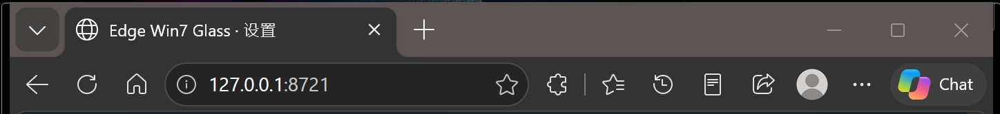
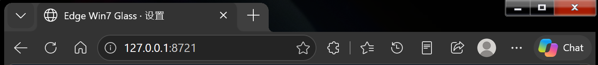

# Edge Win7 Glass

给 Windows 11 上的 Chromium 系浏览器（Edge / Chrome / Brave / Vivaldi / Chromium / Opera / Yandex / Thorium）
换上 **Windows 7 Aero 玻璃标题栏**：四边各切一条窄边露出 DWM 玻璃，右上角整块挖掉交给
[OpenGlass](docs/openglass-config-reference.md) 画 Win7 胶囊按钮 `− □ ✕`，标签条保持 Chromium **原生**。

**之前** —— 现代 Edge 自绘标题栏：顶部一条不透明，右上角是 Chromium 自己的 `− □ ✕`。



**之后** —— 四边露出玻璃，右上角换成 OpenGlass 画的 Win7 胶囊按钮，标签依旧原生。



> 截图里的窗口外观来自 [Aero11: Seven](https://github.com/Sand216/Aero11)（Aero10 的 Win11 移植版，
> Windows 7 主题）+ OpenGlass 提供的玻璃与胶囊按钮。本项目不替换主题、不注入浏览器进程，
> 它只改**窗口形状**（`SetWindowRgn`）：

1. 四边各切 `frame_px`（默认 5 CSS px），露出 DWM 本来就在那儿渲染的玻璃；
2. 右上角从原生 `+` 右侧到窗口右缘整块挖掉，让 OpenGlass 在那里画 Win7 指标的胶囊按钮；
3. 挖掉的角上盖一个 alpha=1 的**隐形分层窗口**，鼠标点它时转成 `WM_SYSCOMMAND`（最小化/最大化/关闭），
   空白处拖动、双击最大化，洞内任何点击把窗口拉到前台；
4. 标签条本身一个字不动 —— 图标、文字、`×`、`+`、拖拽重排全部是 Chromium 自己的行为。

## 前置条件

| 项 | 说明 |
|---|---|
| Windows 11 | 依赖 DWM 的系统玻璃 |
| [OpenGlass](https://github.com/ALTaleX531/OpenGlass) | 系统玻璃/圆角/胶囊按钮都由它提供，**必须装** |
| OpenGlass 配置 | `CaptionButtons = 2`（Win7 指标的三颗胶囊）、`CornerRadius` 与设置里的 `corner_px` 一致（默认 10）。详见 [docs/openglass-config-reference.md](docs/openglass-config-reference.md) |
| 主题（可选，截图即此配置） | [Aero11](https://github.com/Sand216/Aero11) 之类的 Win7 主题，给窗口带来 Win7 的边框/配色；不装也能用，只是边框观感偏 Win11 |

## 安装

### 一、直接用现成的 exe（推荐）

仓库里的 **[`release/`](release/) 目录就是完整的免安装包**，`EdgeWin7Glass.exe` 已经在里面：

- **安装到系统**（开始菜单 + 桌面快捷方式 + 卸载项 + 开机自启）：双击 `release\install.bat`；
- **不安装**：直接双击 `release\EdgeWin7Glass.exe` 常驻运行。

也可以到 [Releases](../../releases) 下载打包好的 `EdgeWin7Glass-1.1.1.zip`（内容与 `release/` 相同）。

- 安装位置：`%LOCALAPPDATA%\Programs\EdgeWin7Glass`（**不需要管理员**）；`install.bat /noautostart` 可跳过开机自启；
- **卸载**：设置 → 应用 → 已安装的应用 → *Edge Win7 Glass*，或双击 `release\uninstall.bat`
  （也会被复制到安装目录的 `Uninstall.bat`）。卸载会优雅退出守护进程、还原窗口形状、
  删除快捷方式和注册表项；设置和日志默认保留，加 `/purge` 一起删。

### 二、从源码跑

```bash
git clone <repo> && cd edge-win7-glass
python -m venv .venv
.venv/Scripts/python.exe -m pip install -r requirements.txt

.venv/Scripts/pythonw.exe tools/native/gt_daemon.py            # 无控制台常驻
.venv/Scripts/python.exe  tools/native/gt_daemon.py --console  # 前台看日志
tools\native\launch.bat                                        # 同上（用项目 .venv 的 pythonw）
```

只需要 Python 3.9+ 和 `comtypes`（读浏览器 UI Automation 拿标签带高度）。无第三方 GUI 框架。

## 使用

- 启动后常驻托盘，**自动接管所有** Chromium 系浏览器窗口，新建窗口约 1 秒内接管：
  `msedge / chrome / brave / vivaldi / chromium / opera / yandex / thorium`。
- 托盘图标：左键 = 打开设置页；右键 = 版本号 / 设置页 / 暂停接管 / 开机自启 / 响应速度 / 重启 / 退出。
- 响应速度（托盘右键子菜单，即时生效，写入 `settings.json` 的 `speed`）：省电（CPU 最低）/ 均衡 / 极速（默认，响应最快）。
  自动降频：窗口布局 1.5 秒没变化且你没在该窗口操作时，轮询慢 4 倍，一有动静立即恢复（`settings.json` 的 `auto_idle` 可关）。
  实测空闲 2 个窗口约占单核 5% / 9% / 14%（省电 / 均衡 / 极速），内存约 65 MB。
- 设置页 <http://127.0.0.1:8721/>（端口被占用自动 +1），改完点「保存并应用」**即时生效**，
  不重启浏览器、不动标签页。
- 托盘「退出」会还原所有窗口形状；用任务管理器强杀会留下挖孔，重开一次或
  `EdgeWin7Glass.exe --reset` 即可清掉。

命令行（单窗口调试模式）：

```bash
# 只接管一个窗口
.venv/Scripts/python.exe tools/native/glass_titlebar.py --pid <msedge pid>
.venv/Scripts/python.exe tools/native/glass_titlebar.py --hwnd 0x20FC4

# 只还原窗口形状（清残留挖孔）
.venv/Scripts/python.exe tools/native/glass_titlebar.py --hwnd 0x20FC4 --reset

# 只接管某个 hwnd，其余不动
GT_ONLY_HWND=0x20FC4 .venv/Scripts/python.exe tools/native/gt_daemon.py --console
```

配置写在 `%APPDATA%\edge-win7-glass\settings.json`，日志在 `%APPDATA%\edge-win7-glass\daemon.log`。
字段逐条说明见 [docs/settings.md](docs/settings.md)。

## 已验证

在 200% DPI 的 Win11 + Edge 157 上实测：

| 操作 | 结果 |
|---|---|
| 点标签 / `×` / `+` / 左侧箭头 | 切换 / 关闭 / 新建标签 / 标签搜索，全部原生行为 |
| 胶囊 `− □ ✕` | 由隐形覆盖窗转 `WM_SYSCOMMAND`，命中表与挖孔同一几何来源 |
| 拖空白处 / 双击空白处 | 移动窗口 / 最大化还原 |
| 全屏 F11 | 立即清洞并交还系统，退出全屏重新接管 |
| 窗口移动 / 最大化 | 洞与覆盖层跟随（UIA 每 0.2 s 采样） |
| 1 / 4 / 12 个标签 | 挖孔左边界跟着 `+` 走，点击精度不变 |
| 多窗口切换 | 覆盖窗 Z 序跟随前台 |

## 已知限制

- **四边窄边会吃掉一点内容**：`frame_px` 越大露玻璃越多，内容边缘被切掉的也越多，5 CSS px 是观感和可用性的折中。
- **四边 resize 未接管**：仍靠原生边框区域。
- **OpenGlass 胶囊没有悬停/按压反馈**：只做点击转发。
- **多显示器 / 混合 DPI**：`scale` 取自目标窗口自身 DPI，跨屏拖动未充分测试。
- **强杀进程会残留挖孔**：重启或 `--reset` 兜底。
- **Chromium 最小宽度 500 DIP**：更窄的缩放会被系统拒绝，不是本项目的 bug。

技术细节、踩过的坑、为什么不用注入/改 Chromium，全部记录在
[docs/FINDINGS.md](docs/FINDINGS.md)（长文，按实验轮次编排）。

## 目录

```
tools/native/
  gt_daemon.py        常驻服务：窗口扫描/接管、托盘、本地设置页、开机自启
  glass_titlebar.py   核心：frame_region 挖洞、win7_caption_buttons 指标、TouchOverlay、attach_loop
  gt_i18n.py          托盘/设置页的中英文文案
  launch.bat          无控制台启动守护进程
release/
  EdgeWin7Glass.exe   打包好的程序（PyInstaller onefile，免安装可直接运行）
  install.bat         一键安装（复制到 %LOCALAPPDATA%，建快捷方式，注册卸载）
  uninstall.bat       一键卸载（/purge 连设置和日志一起删）
  README.txt          随包分发的用户说明
  settings.md         settings.json 字段说明（随包附带）
docs/
  settings.md                  settings.json 字段说明
  FINDINGS.md                  开发记录与根因分析
  openglass-config-reference.md OpenGlass 配置说明（上游文档快照）
img/
  initial.png / effect.png     README 里的前后对比截图
requirements.txt      运行时依赖（comtypes）
```

## 从源码打包 exe

```bash
.venv/Scripts/python.exe -m pip install pyinstaller
.venv/Scripts/pyinstaller.exe --onefile --noconsole --name EdgeWin7Glass \
    --paths tools/native tools/native/gt_daemon.py
```

打包 = 把新 exe 放进 `release/`，再把 `release/` 里五个文件压成 `EdgeWin7Glass-<版本>.zip`：

```bash
cp dist/EdgeWin7Glass.exe release/
cd release && "/c/Program Files/7-Zip/7z.exe" a -tzip ../dist/EdgeWin7Glass-1.1.1.zip \
    EdgeWin7Glass.exe install.bat uninstall.bat README.txt settings.md
```

## 许可

[MIT](LICENSE)
